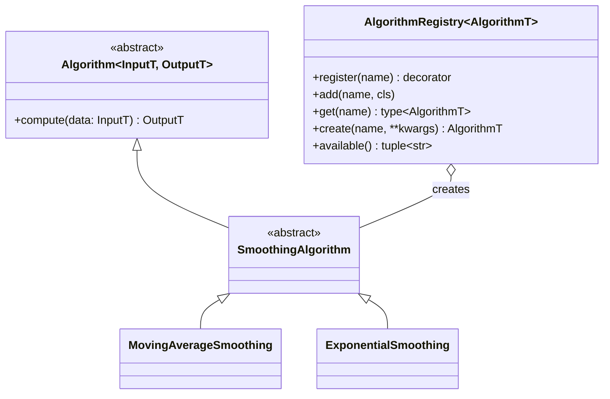
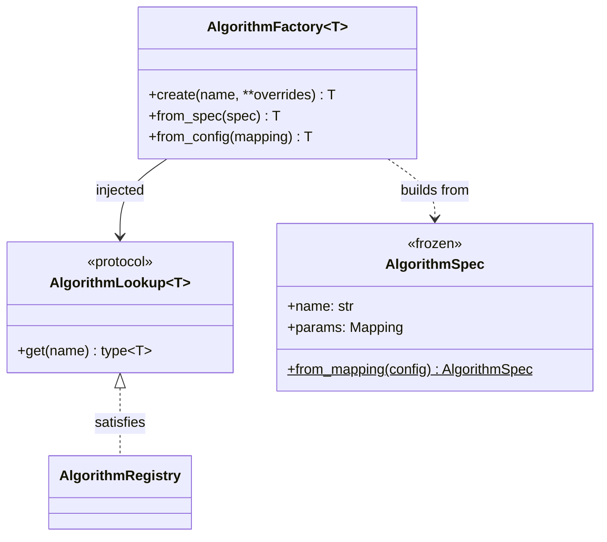
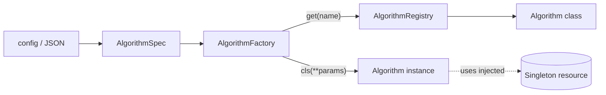

# Usage guide — `algorithm_registry`

A generic, type-safe **Strategy + Registry** for interchangeable algorithms,
generalised from `pycomets/road_geometry/curvature/algorithms.py`.

The package is stdlib-only and split into independent modules, one per pattern:

| Module | Pattern | Depends on |
| --- | --- | --- |
| [algorithm.py](src/algorithm_registry/algorithm.py) | Strategy + Registry (sections 1–8) | — |
| [factory.py](src/algorithm_registry/factory.py) | Factory (section 9) | `algorithm.py` |
| [singleton.py](src/algorithm_registry/singleton.py) | Singleton (section 10) | — |

Each file can be copied into another project on its own (plus `algorithm.py`
for the factory).

## 1. Building blocks



| Piece | Responsibility |
| --- | --- |
| `Algorithm[InputT, OutputT]` | Generic interface with one abstract `compute()` |
| *Family base* (e.g. `SmoothingAlgorithm`) | Fixes the input/output types for one family |
| `AlgorithmRegistry[AlgorithmT]` | Name → class map + factory for one family; knows nothing about the domain |
| `AlgorithmError` tree | Typed failures, catchable as a group |

## 2. Define a family in three steps

```python
from collections.abc import Sequence

from algorithm_registry import Algorithm, AlgorithmRegistry


# 1. A family base that fixes the input/output types.
class SmoothingAlgorithm(Algorithm[Sequence[float], list[float]]):
    """Base class shared by every smoothing algorithm."""


# 2. One registry instance per family (the annotation sets its type).
smoothers: AlgorithmRegistry[SmoothingAlgorithm] = AlgorithmRegistry(
    SmoothingAlgorithm, family="smoothing algorithm"
)


# 3. Concrete algorithms register themselves by name.
@smoothers.register("identity")
class IdentitySmoothing(SmoothingAlgorithm):
    def compute(self, data: Sequence[float]) -> list[float]:
        return list(data)
```

The full example is in [examples/smoothing.py](examples/smoothing.py):

```bash
uv run python examples/smoothing.py
```

## 3. Select an algorithm at runtime

Callers go through the registry and never import a concrete class, so new
algorithms can be added without touching them.

```python
from smoothing import smoothers

method = config["smoothing_method"]  # e.g. "moving_average"
algorithm = smoothers.create(method)
result = algorithm.compute(signal)
```

Introspection:

```python
smoothers.available()  # ('exponential', 'identity', 'moving_average')
"identity" in smoothers  # True
smoothers.get("identity")  # the class, not an instance
```

## 4. Algorithms with parameters

Put configuration in `__init__`; `create()` forwards keyword arguments to the
constructor. Validate there so bad configuration fails before any data is
processed, and validate data size in `compute()`:

```python
from algorithm_registry import AlgorithmConfigurationError, AlgorithmInputError


@smoothers.register("moving_average")
class MovingAverageSmoothing(SmoothingAlgorithm):
    def __init__(self, window: int = 3) -> None:
        if window < 1:
            raise AlgorithmConfigurationError(f"window must be >= 1, got {window}.")
        self._window = window

    def compute(self, data: Sequence[float]) -> list[float]:
        if len(data) < self._window:
            raise AlgorithmInputError(f"need at least {self._window} samples.")
        ...


algorithm = smoothers.create("moving_average", window=5)
```

## 5. Adding a new algorithm (Open/Closed)

1. Subclass the family base and implement `compute()`.
2. Decorate it with `@<registry>.register("<unique_name>")`.
3. Make sure the defining module is imported (e.g. from the package
   `__init__.py`) so registration runs.

No existing algorithm, the registry, or any caller changes. Avoid
`if method == "...":` ladders — the registry *is* the dispatch.

For plugins discovered at runtime, register without a decorator:

```python
smoothers.add("plugin_x", PluginXSmoothing)
```

## 6. Error handling

Every error derives from `AlgorithmError` **and** from the closest built-in,
so both narrow and broad handlers work.

| Error | Also a | Raised when |
| --- | --- | --- |
| `AlgorithmNotFoundError` | `LookupError` | `get()`/`create()` with an unknown name (message lists available names) |
| `AlgorithmAlreadyRegisteredError` | `ValueError` | A name is registered twice |
| `InvalidAlgorithmError` | `TypeError` | Blank name, class not a subclass of the base, or class still abstract |
| `AlgorithmConfigurationError` | `ValueError` | Constructor rejects its parameters (raise it in your `__init__`) |
| `AlgorithmInputError` | `ValueError` | `compute()` cannot process the input (raise it in your `compute`) |

Registration errors surface at **import time**, so a misconfigured algorithm
never reaches production silently.

```python
from algorithm_registry import AlgorithmError

try:
    result = smoothers.create(method, **options).compute(signal)
except AlgorithmError as exc:
    raise MyAppError(f"Smoothing failed: {exc}") from exc
```

## 7. Testing

Registries are plain instances, not class-level globals, so each test can
build an isolated registry with fakes — no snapshot/restore needed:

```python
from algorithm_registry import AlgorithmRegistry


class FakeSmoothing(SmoothingAlgorithm):
    def compute(self, data):
        return list(data)


def test_with_isolated_registry() -> None:
    local: AlgorithmRegistry[SmoothingAlgorithm] = AlgorithmRegistry(SmoothingAlgorithm)
    local.add("fake", FakeSmoothing)
    assert local.create("fake").compute([1.0]) == [1.0]
```

Quality gate:

```bash
uv run ruff format
uv run ruff check --fix
uv run mypy
uv run pytest
```

## 8. Migrating `curvature/algorithms.py`

| Curvature module | Generic equivalent |
| --- | --- |
| `CurvatureAlgorithm(ABC)` with `compute(data: Dataset) -> np.ndarray` | `class CurvatureAlgorithm(Algorithm[Dataset, np.ndarray])` |
| `AlgorithmRegistry` with class-level `_registry` dict | `curvature_algorithms = AlgorithmRegistry(CurvatureAlgorithm, family="curvature algorithm")` |
| `AlgorithmRegistry.register("vectorized")(VectorizedAlgorithm)` | `@curvature_algorithms.register("vectorized")` on the class |
| `AlgorithmRegistry.create(method, **kwargs)` | `curvature_algorithms.create(method, **kwargs)` |
| `ValueError("offset must be at least 1")` | `AlgorithmConfigurationError(...)` |
| `ValueError("... requires at least N rows")` | `AlgorithmInputError(...)` |

```python
import numpy as np

from algorithm_registry import (
    Algorithm,
    AlgorithmConfigurationError,
    AlgorithmInputError,
    AlgorithmRegistry,
)
from pycomets.dataset import Dataset


class CurvatureAlgorithm(Algorithm[Dataset, np.ndarray]):
    """Strategy interface for road-radius estimation algorithms."""


curvature_algorithms: AlgorithmRegistry[CurvatureAlgorithm] = AlgorithmRegistry(
    CurvatureAlgorithm, family="curvature algorithm"
)


@curvature_algorithms.register("vectorized")
class VectorizedAlgorithm(CurvatureAlgorithm):
    def __init__(self, offset: int = 5) -> None:
        if offset < 1:
            raise AlgorithmConfigurationError("offset must be at least 1")
        self._offset = offset

    def compute(self, data: Dataset) -> np.ndarray:
        if len(data) < 2 * self._offset + 1:
            raise AlgorithmInputError(
                f"Vectorized curvature needs at least {2 * self._offset + 1} rows."
            )
        ...  # unchanged maths
```

What you gain over the original:

- **Reusable** — the same file serves any family (smoothing, curvature,
  resampling, …) with its own types.
- **Isolated state** — one registry per family instead of a class-level dict
  shared by every subclass and every test.
- **Safer registration** — blank names, wrong base classes and abstract
  classes are rejected at import time.
- **Typed** — `create()` returns the family base type, so `mypy --strict`
  checks what you do with the result.

## 9. Factory — `AlgorithmFactory`

The registry answers *which class* is registered under a name. The factory
owns *how* it is built, so construction policy lives in one place instead of
being repeated at every call site:

- **Per-algorithm defaults**, validated eagerly when the factory is created —
  a typo in a default fails at start-up, not on first use.
- **Parameter validation** against the constructor signature; unknown or
  missing arguments become `AlgorithmConfigurationError` (original
  `TypeError` kept as `__cause__`).
- **Config parsing at the boundary** — `AlgorithmSpec.from_mapping()` turns an
  untrusted JSON/YAML/TOML mapping into an immutable, validated spec.
- **Dependency inversion** — the factory depends on the one-method
  `AlgorithmLookup` protocol, not on `AlgorithmRegistry`, so any object with
  `get(name) -> type` can back it (e.g. a fake in tests or a plugin catalog).



```python
from algorithm_registry import AlgorithmFactory
from smoothing import SmoothingAlgorithm, smoothers

factory: AlgorithmFactory[SmoothingAlgorithm] = AlgorithmFactory(
    smoothers,
    defaults={"moving_average": {"window": 2}, "exponential": {"alpha": 0.3}},
)

factory.create("moving_average")  # window=2 from defaults
factory.create("moving_average", window=4)  # overrides win
factory.from_config({"method": "exponential", "params": {"alpha": 0.8}})
```

Rejected configuration is explicit and diagnosable:

```text
Invalid parameters ['window', 'windw'] for 'moving_average'
(MovingAverageSmoothing(window: 'int' = 3)): got an unexpected keyword argument 'windw'.
```

| `from_config` input | Result |
| --- | --- |
| `{"method": "identity"}` | OK — `params` is optional |
| `{"params": {...}}` / `{"method": 3}` | `AlgorithmConfigurationError` — `method` required, must be `str` |
| `{"method": "x", "params": [1]}` | `AlgorithmConfigurationError` — `params` must be a mapping with `str` keys |
| `{"method": "x", "extra": 1}` | `AlgorithmConfigurationError` — unknown keys are not ignored |
| `{"method": "unknown"}` | `AlgorithmNotFoundError` |

Use custom key names with
`AlgorithmSpec.from_mapping(config, name_key="type", params_key="options")`.

Full example: [examples/factory_example.py](examples/factory_example.py).

## 10. Singleton — `SingletonMeta`

> **Architecture note.** A singleton is global state with a constructor. In
> Python the idiomatic “one instance” is a **module-level object** (the
> `smoothers` registry already is one) combined with **dependency
> injection**. Use `SingletonMeta` only when the *class itself* must guarantee
> one instance per process — typically an expensive, read-only shared
> resource (calibration table, model weights, connection pool).

Guarantees:

| Property | Behaviour |
| --- | --- |
| Lazy | Built on first call; a failed `__init__` is not cached, the next call retries |
| Thread-safe | Double-checked locking with a re-entrant lock (nested singletons don't deadlock) |
| Per class | Each subclass gets its own instance |
| Explicit configuration | `C()` always returns the instance; `C(**args)` with values different from the first call raises `SingletonArgumentsError` (names only, values are never echoed) |
| ABC-compatible | Derives from `ABCMeta`, so it combines with `Algorithm` bases |
| Testable | `C.reset_instance()` drops the cached instance |

```python
from algorithm_registry import SingletonMeta


class CalibrationTable(metaclass=SingletonMeta):
    def __init__(self, gain: float = 2.0) -> None:
        self.gain = gain  # imagine an expensive load here


class CalibratedSmoothing(SmoothingAlgorithm):
    def __init__(self, table: CalibrationTable | None = None) -> None:
        # Inject; fall back to the shared instance only as a default.
        self._table = table if table is not None else CalibrationTable()

    def compute(self, data):
        return [value * self._table.gain for value in data]


CalibrationTable() is CalibrationTable()  # True
CalibrationTable(gain=5.0)  # SingletonArgumentsError
```

A singleton algorithm also works through the registry — `create()` then
returns the same instance every time:

```python
class SharedIdentity(SmoothingAlgorithm, metaclass=SingletonMeta): ...
```

Testing rules:

- Reset in an autouse fixture: `CalibrationTable.reset_instance()`.
- Prefer injecting a fake (a subclass gets its own instance) over resetting
  the shared one.

Caveats: one instance **per process** (not across `multiprocessing` workers);
`copy`/`pickle` can still produce a second object; `AlgorithmFactory` cannot
validate parameters of singleton classes ahead of time because their
constructor signature is hidden behind the metaclass.

Full example: [examples/singleton_example.py](examples/singleton_example.py).

## 11. Which pattern when?

| Need | Use |
| --- | --- |
| Swap the algorithm by name, extend without touching callers | `AlgorithmRegistry` (Strategy + Registry) |
| Centralise defaults, validate parameters, build from config files | `AlgorithmFactory` on top of a registry |
| Exactly one shared instance of an expensive resource | Module-level instance + injection; `SingletonMeta` if the class must enforce it |


